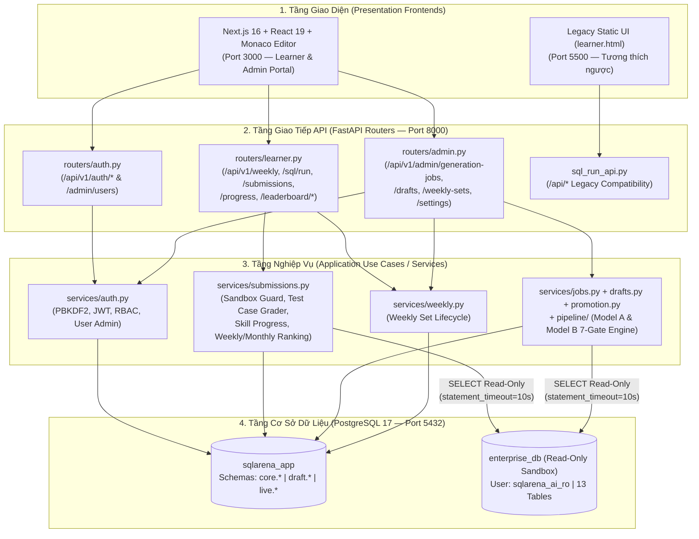

# 🚀 SQLArena AI — Hệ Thống Sinh Đề SQL Tự Động 2-Model, Read-Only Sandbox & Bảng Xếp Hạng Thời Gian Thực

> **Đồ án PTIT — Phiên bản Hợp nhất Toàn diện (Unified Architecture v7 · PostgreSQL 17 · FastAPI · Next.js 16 + React 19)**

---

## 📋 1. Tổng Quan Dự Án & Phân Công Nhiệm Vụ (3 Thành Viên)

**SQLArena AI** là nền tảng luyện tập và thi đấu truy vấn SQL trên dữ liệu doanh nghiệp thật (**Enterprise Dataset PostgreSQL 17 — 13 bảng, >13.400 bản ghi**), kết hợp **Pipeline AI 2-Model (Model A sinh đề + Model B độc lập giải kiểm chứng qua 7 cổng)** để tự động tạo và kiểm duyệt câu hỏi chất lượng cao.

| Thành viên | Vai trò phụ trách | Các phân hệ đã hoàn thiện & hợp nhất trong Repo |
|---|---|---|
| **Hưng** | **AI Pipeline & Question Management Backend** | • Tích hợp Pipeline **Model A (Generator)** & **Model B (Reviewer/Self-Solver)** (`ai/` & `backend/app/pipeline/`).<br>• Hệ thống 7 cổng kiểm định tự động (Blueprint, Self-Solve Consensus trên Base + Mutant Datasets, Code Check, Semantic Audit, Checklist, Test Case Promotion).<br>• Quản lý trạng thái Job (`draft.generation_jobs`), câu hỏi nháp (`draft.question_drafts`), lịch sử giải (`draft.self_solve_runs`), kiểm duyệt thủ công (`needs_human` → `approve`/`reject`/`edit`) và ngân sách LLM (`draft.llm_call_ledger`).<br>• Quản lý vòng đời Bộ đề tuần (`live.weekly_sets`: `draft` → `published` → `closed`). |
| **Đạt** | **SQL Sandbox, Submission, Grading & Leaderboard Backend** | • Thiết kế & nạp **Enterprise Dataset PostgreSQL** (`enterprise_db`, 13 bảng nghiệp vụ thương mại điện tử & nhân sự).<br>• Cơ chế **Read-Only SQL Sandbox** an toàn tuyệt đối: Role PostgreSQL chỉ đọc (`sqlarena_ai_ro`), `SET LOCAL TRANSACTION READ ONLY`, `statement_timeout`, bộ lọc AST/Regex chặn mọi lệnh DML/DDL (`INSERT/UPDATE/DELETE/DROP/ALTER/COPY...`).<br>• Bộ chấm điểm tự động (`compare_result`): đối chiếu kết quả thực thi SQL của người học với `expected_result` (`ordered` / `unordered`).<br>• Tính toán **Bảng xếp hạng Tuần & Tháng** theo số câu giải đúng (`PASS`), điểm số và thời gian hoàn thành sớm nhất. |
| **Nguyên** *(Chủ trì)* | **Frontend Next.js 16, Auth/RBAC, Remaining Features & System Integration** | • **Hợp nhất kiến trúc Phương án B (Clean Architecture Design v7)** trên một Backend FastAPI duy nhất và Database chuẩn (`core.*`, `draft.*`, `live.*`).<br>• Phát triển đầy đủ **Xác thực & Quản lý Tài khoản** (`/api/v1/auth/*`, `/api/v1/admin/users/*`): Đăng ký, Đăng nhập JWT (HS256 + PBKDF2-HMAC-SHA256), Phân quyền (`learner` / `admin`), Hồ sơ cá nhân, Đổi mật khẩu, Khóa/Mở khóa tài khoản.<br>• Phát triển **Thống kê Tiến độ & Độ thông thạo 6 Kỹ năng SQL (`S1`–`S6`)** (`/api/v1/progress`).<br>• Nâng cấp **Frontend React 19 + Next.js 16 + Tailwind v4 + Monaco SQL Editor** (`frontend/`) kết nối 100% API thật cho cả **Cổng Học Viên** và **Cổng Quản Trị Admin**, đồng thời giữ nguyên `learner.html` chạy song song.<br>• Đóng gói **Docker Compose**, viết bộ **48 Integration/E2E Tests (`pytest`)** trên PostgreSQL 17 thật và tài liệu vận hành. |

---

## 🏛️ 2. Kiến Trúc Hệ Thống Hợp Nhất (Clean Architecture — Design v7)

Dự án tuân thủ chặt chẽ kiến trúc phân tầng (**Clean Architecture**) để dễ bảo trì, mở rộng và kiểm thử:



### Cấu trúc Thư mục Chuẩn của Dự án

```text
sqlarena-ai/
├── ai/                         # Engine AI gốc (Model A Generator, Model B Reviewer, Mutant Datasets)
├── backend/                    # Unified FastAPI Backend (Clean Architecture)
│   ├── alembic/                # Quản lý Migration tự động (0001 -> 0002 -> 0003)
│   ├── db/                     # SQL DDL chuẩn cho các schema core.*, draft.*, live.*
│   │   ├── 0001_baseline.sql
│   │   ├── 0002_weekly_sets.sql
│   │   └── 0003_submissions_and_leaderboard.sql
│   ├── seed/                   # Dữ liệu hạt giống (core_seed.json: Enterprise World, 6 Skills, 50 Đề nguồn)
│   ├── app/
│   │   ├── main.py             # Composition Root & FastAPI App Entrypoint
│   │   ├── cli.py              # CLI vận hành (migrate, seed, seed-demo, worker, check)
│   │   ├── config.py           # Cấu hình tập trung từ biến môi trường
│   │   ├── db.py               # SQLAlchemy Connection Pool & Helpers
│   │   ├── domain.py           # Hằng số & Quy tắc miền nghiệp vụ (Domain Rules)
│   │   ├── schemas.py          # Pydantic Request/Response Contracts
│   │   ├── security.py         # JWT HS256 & Dependency Injection phân quyền
│   │   ├── routers/            # Tầng HTTP Controllers (auth.py, learner.py, admin.py, health.py)
│   │   ├── services/           # Tầng Use Cases (auth.py, submissions.py, drafts.py, jobs.py, weekly.py...)
│   │   └── pipeline/           # Tầng tích hợp AI Worker & Lease/Heartbeat
│   └── tests/                  # Bộ 48 bài kiểm thử tích hợp trên PostgreSQL 17 thật
├── frontend/                   # Giao diện Hiện đại Next.js 16 + React 19 + Tailwind v4 + Monaco Editor
│   └── src/
│       ├── app/                # Next.js App Router (page.tsx, home-client.tsx)
│       ├── components/         # AuthBar, LearnerWorkbench, ProgressAndLeaderboard, AdminPortal...
│       └── lib/                # Typed Axios API Client (api.ts)
├── postgre/                    # SQL khởi tạo Enterprise Dataset (13 bảng) & Read-Only Role
├── docs/                       # Tài liệu kiến trúc & FEATURE_INDEX.md
├── learner.html                # Giao diện HTML tĩnh tốc độ cao (chạy song song trên cổng 5500)
└── docker-compose.yml          # Điều phối toàn bộ hệ thống (Postgres 17 + Backend + Worker + Frontend)
```

---

## 🗄️ 3. Thiết Kế Cơ Sở Dữ Liệu (PostgreSQL 17)

Hệ thống sử dụng **PostgreSQL 17** (tuyệt đối không dùng SQLite giả lập) gồm 2 cụm cơ sở dữ liệu tách biệt quyền hạn:

1. **`sqlarena_app` (Database điều hành ứng dụng — chia làm 3 Schema chuẩn)**:
   - **`core.*`**: `core.worlds` (EnterpriseDB v1), `core.skills` (`S1` SELECT/WHERE, `S2` JOIN, `S3` GROUP BY/HAVING, `S4` Subquery/CTE, `S5` Window Functions, `S6` Edge Cases/NULL/Date), `core.source_questions` (50 đề nguồn gốc), `core.system_settings`.
   - **`draft.*`**: `draft.generation_jobs` (hàng đợi job sinh đề), `draft.question_drafts` (câu hỏi nháp AI), `draft.self_solve_runs` (kết quả Model B tự giải), `draft.review_logs` (nhật ký 7 cổng kiểm duyệt), `draft.llm_call_ledger` (kiểm soát chi phí & hạn mức LLM mỗi ngày).
   - **`live.*`**:
     - `live.roles`, `live.users` (Tài khoản người học & quản trị viên, mật khẩu băm `PBKDF2-HMAC-SHA256`).
     - `live.questions`, `live.test_cases` (Ngân hàng câu hỏi đã duyệt & `expected_result` chuẩn hóa).
     - `live.weekly_sets`, `live.weekly_set_items` (Bộ đề tuần đang mở & lịch sử các tuần).
     - `live.submissions` (Lịch sử nộp bài, điểm số, thời gian chạy `runtime_ms`, kết quả chấm từng test case).
     - `live.admin_overrides`, `live.audit_logs` (Nhật ký kiểm toán mọi thao tác của Admin).
2. **`enterprise_db` (Database Sandbox thực thi SQL của người học)**:
   - Chứa **13 bảng dữ liệu doanh nghiệp thật**: `categories`, `products`, `suppliers`, `warehouses`, `inventory`, `departments`, `employees`, `customers`, `orders`, `order_items`, `payments`, `shipments`, `refunds`.
   - Mọi truy vấn từ người học hoặc AI được thực thi qua tài khoản PostgreSQL **`sqlarena_ai_ro`** (chỉ có quyền `SELECT`), bọc trong `SET LOCAL TRANSACTION READ ONLY` và `statement_timeout = 10000ms`.

---

## ⚡ 4. Hướng Dẫn Cài Đặt & Vận Hành Từng Bước

### Cách 1: Chạy trực tiếp trên máy (Local Development — Khuyên dùng để Demo nhanh)

#### Bước 1: Khởi tạo PostgreSQL 17 & Enterprise Sandbox
Đảm bảo PostgreSQL 17 đang chạy ở cổng `5432`, sau đó nạp Enterprise Dataset (nếu chạy lần đầu):
```bash
psql -U postgres -c "CREATE DATABASE enterprise_db;"
psql -U postgres -c "CREATE DATABASE sqlarena_app;"
psql -U postgres -d enterprise_db -f postgre/enterprise_db/schema_code.sql
psql -U postgres -d enterprise_db -f postgre/enterprise_db/constraint.sql
psql -U postgres -d enterprise_db -f postgre/enterprise_db/enterprise_seed_data.sql
psql -U postgres -d enterprise_db -f postgre/sqlarena_db/03_create_readonly_role.sql
```

#### Bước 2: Chạy Migration & Nạp Dữ Liệu Demo Chuẩn (`seed-demo`)
```bash
python3 -m venv .venv
source .venv/bin/activate
pip install -r backend/requirements.txt

cd backend
python -m app.cli migrate
python -m app.cli seed-demo
```
> Lệnh `python -m app.cli seed-demo` sẽ tự động:
> 1. Nạp World Enterprise, 6 nhóm kỹ năng `S1–S6` và 50 câu hỏi nguồn vào `core.*`.
> 2. Tạo 5 tài khoản mẫu (`admin`, `nguyen_ptit`, `tuan_le`, `ha_nguyen`, `minh_pham`).
> 3. Promote 50 câu hỏi sang `live.questions`, chạy `reference_sql` trên `enterprise_db` để sinh `expected_result` chuẩn vào `live.test_cases`.
> 4. Mở bộ đề **Tuần #42 — Thử thách SQL Doanh nghiệp** gồm 20 câu hỏi (5 Easy, 10 Medium, 5 Hard).
> 5. Tạo sẵn các Draft câu hỏi AI ở trạng thái `needs_human` và dữ liệu bài nộp mẫu để Bảng xếp hạng & Trang Kiểm duyệt Admin có dữ liệu trực quan ngay lập tức.

#### Bước 3: Khởi động Backend FastAPI (Cổng `8000`)
```bash
cd backend
../.venv/bin/uvicorn app.main:app --host 127.0.0.1 --port 8000 --reload
```
- **Swagger UI / OpenAPI Docs**: [http://127.0.0.1:8000/api/docs](http://127.0.0.1:8000/api/docs)

#### Bước 4: Khởi động Frontend Next.js 16 + React 19 (Cổng `3000`)
```bash
cd frontend
npm install
npm run dev -- -p 3000 -H 127.0.0.1
```
- **Giao diện Next.js 16 (Chính)**: [http://127.0.0.1:3000](http://127.0.0.1:3000)
- **Giao diện HTML tĩnh tương thích ngược (`learner.html`)**: [http://127.0.0.1:5500/learner.html](http://127.0.0.1:5500/learner.html) *(chạy bằng `python3 -m http.server 5500`)*

#### Bước 5: Nguồn dữ liệu & Cơ chế Sinh Đề AI (2 Chế độ: Parametric SQL Synthesizer vs. Local Ollama 2-Model Worker)

Khi Admin bấm nút **"Khởi chạy Job Sinh đề AI"** trên tab `04 · Quản trị -> Sinh đề AI`, hệ thống lấy **dữ liệu nguồn từ 3 tầng trong PostgreSQL 17**:
1. **Tầng 1 — Enterprise Database (`enterprise_db` — 13 bảng dữ liệu thật, >13.400 dòng)**:
   - Được nạp từ `postgre/enterprise_db/schema_code.sql` và `enterprise_seed_data.sql` (`categories`, `products`, `suppliers`, `warehouses`, `inventory`, `departments`, `employees`, `customers`, `orders`, `order_items`, `payments`, `shipments`, `refunds`).
2. **Tầng 2 — World Metadata & 50 Seed Blueprints (`core.worlds`, `core.skills`, `core.source_questions`)**:
   - Được nạp từ `backend/seed/core_seed.json` khi chạy `python -m app.cli seed-demo`, chứa mô tả schema, khóa ngoại (`fk_relations`), quy tắc nghiệp vụ (`business_rules`), bẫy dữ liệu (`planted_traps`) và 50 mẫu câu hỏi chuẩn theo 6 nhóm kỹ năng `S1–S6`.
3. **Tầng 3 — Bộ tổng hợp câu hỏi có kiểm chứng thực thi (`backend/app/services/jobs.py` & `ai/main.py`)**:
   - Hỗ trợ **2 chế độ hoạt động** để cả nhóm và giảng viên đều test được ngay lập tức:
   - **Chế độ A — Parametric SQL Synthesizer + Live Sandbox Verifier (`auto_run: true`, mặc định trên Web UI — KHÔNG cần cài Ollama)**:
     - Hệ thống sử dụng các khung truy vấn tham số hóa (`_PARAM_TEMPLATES` trong `backend/app/services/jobs.py`: lọc ngưỡng giá `list_price`, ngưỡng số đơn hàng `HAVING COUNT >= N`, phân nhóm `GROUP BY`, xếp hạng cửa sổ `DENSE_RANK() OVER (PARTITION BY ...)`), kết hợp với `topic`, `difficulty`, `skill_ids` do Admin chọn.
     - Trước khi lưu, hệ thống **quét toàn bộ `live.questions` và `draft.question_drafts` để chống trùng lặp 100%** với 50 câu gốc, sau đó **chạy trực tiếp câu lệnh `reference_sql` trên `enterprise_db` thật** để kiểm chứng số dòng trả về (`row_count > 0`) rồi mới ghi vào `draft.question_drafts` (`status = 'needs_human'`) và `draft.self_solve_runs`.
     - Khi Admin sang tab **`Duyệt đề`** và bấm **"Phê duyệt & Đưa vào Ngân hàng đề"**, Backend (`backend/app/services/drafts.py`) thực thi lại `reference_sql` trên `enterprise_db`, đóng gói kết quả chuẩn (`expected_columns`, `expected_rows`, `result_hash`) vào `live.test_cases` và phát hành câu hỏi sang `live.questions` (`status = 'ready'`).
   - **Chế độ B — Local Ollama 2-Model Worker (`auto_run: false` + chạy tiến trình `python -m app.cli worker`)**:
     - Nếu máy có cài [Ollama](https://ollama.com) ở cổng `11434`, kéo 2 model local về và bật Worker chạy ngầm:
     ```bash
     ollama pull llama3
     ollama pull qwen2.5-coder:7b
     cd backend && ../.venv/bin/python -m app.cli worker
     ```
     - Worker lấy `schema_description` + 2 câu mẫu từ `core.source_questions` làm Few-Shot Prompt gửi vào **Model A (Generator)** sinh đề mới, sau đó gọi **Model B (Self-Solver)** độc lập tự giải `k=3` lần trên Base + Mutant Datasets và chấm qua **7 cổng kiểm định** (`ai/review.py`).


---

### Cách 2: Chạy toàn bộ bằng Docker Compose (Production / Staging)

```bash
docker compose up --build -d
```
Docker Compose sẽ tự động dựng 4 container:
1. `sqlarena-postgres` (PostgreSQL 17 — cổng `5432`)
2. `sqlarena-backend` (FastAPI Unified API — cổng `8000`, tự động chạy `migrate` + `seed-demo`)
3. `sqlarena-worker` (Background AI Generation & Review Worker)
4. `sqlarena-frontend` (Next.js 16 App — cổng `3000`)

---

## 🔑 5. Tài Khoản Demo & Hướng Dẫn Trải Nghiệm Nhanh

Trên thanh Header của giao diện **[http://127.0.0.1:3000](http://127.0.0.1:3000)** có sẵn cụm nút **"Chuyển nhanh" (1-Click Switch)** giúp giảng viên/người chấm chuyển đổi tức thì giữa Học viên và Admin mà không cần nhập lại mật khẩu:

| Vai trò | Username / Email | Mật khẩu | Quyền hạn & Tính năng trải nghiệm |
|---|---|---|---|
| **🎓 Học viên (Learner)** | `nguyen_ptit`<br>(`learner@sqlarena.local`) | `demo123` | • Xem bộ đề tuần đang mở, lọc câu hỏi theo độ khó (`Easy`/`Medium`/`Hard`), trạng thái đã giải.<br>• Viết truy vấn trên **Monaco SQL Editor**, xem cấu trúc 13 bảng Enterprise DB.<br>• Nhấn **▶ Chạy thử SQL** (thực thi trên Read-Only Sandbox) hoặc **🚀 Nộp bài & Chấm Test Case**.<br>• Xem **Tiến độ & Độ thông thạo 6 kỹ năng SQL (`S1–S6`)** và **Bảng xếp hạng Tuần / Tháng**. |
| **🛡️ Quản trị viên (Admin)** | `admin`<br>(`admin@sqlarena.local`) | `admin123` | • **Kiểm duyệt Câu hỏi nháp (Human-in-the-Loop)**: Xem các draft AI ở trạng thái `needs_human`, đối chiếu lời giải Model B, sửa nội dung đề, **Phê duyệt (Approve)** để đưa vào ngân hàng câu hỏi hoặc **Từ chối (Reject)**.<br>• **Khởi chạy AI Pipeline**: Tạo Job sinh đề mới cho Model A + Model B, theo dõi hạn mức LLM.<br>• **Quản lý Bộ đề Tuần**: Xuất bản (`Publish`) hoặc đóng (`Close`) bộ đề tuần.<br>• **Quản lý Tài khoản**: Tìm kiếm người dùng, đổi quyền (`learner` ↔ `admin`), khóa/mở khóa tài khoản. |

---

## 🧪 6. Kiểm Thử Tự Động (48/48 Bài Test Đạt 100%)

Toàn bộ hệ thống được kiểm thử tích hợp trực tiếp trên PostgreSQL 17 thật (không dùng mock DB), bao gồm 46 bài test AI Pipeline & Weekly Sets của Hưng và bộ test E2E Auth + SQL Sandbox + Grading + Leaderboard của Nguyên & Đạt:

```bash
cd backend
TEST_PG_ADMIN_DSN="postgresql://postgres@localhost:5432/postgres" \
TEST_ENTERPRISE_USER="sqlarena_ai_ro" \
TEST_ENTERPRISE_PASSWORD="sqlarena_ro" \
TEST_CATALOG_USER="postgres" \
TEST_CATALOG_PASSWORD="" \
../.venv/bin/pytest tests -q
```
Kết quả chuẩn:
```text
................................................                         [100%]
48 passed in 6.51s
```

---

## 📡 7. Danh Mục API Hợp Nhất (`/api/v1/*`)

| Nhóm | Method & Endpoint | Mô tả nghiệp vụ |
|---|---|---|
| **Auth & Hồ sơ** | `POST /api/v1/auth/register` | Đăng ký tài khoản học viên mới & trả về JWT token |
| | `POST /api/v1/auth/login` | Đăng nhập bằng Email hoặc Username |
| | `GET /api/v1/auth/me` | Lấy thông tin hồ sơ & thống kê cá nhân |
| | `PUT /api/v1/auth/me` | Cập nhật tên hiển thị, giới thiệu (bio), ảnh đại diện |
| | `POST /api/v1/auth/change-password` | Đổi mật khẩu bảo mật |
| **Luyện tập & Chấm bài** | `GET /api/v1/weekly/current` | Thông tin bộ đề tuần đang mở & tiến độ cá nhân |
| | `GET /api/v1/weekly/current/questions` | Danh sách câu hỏi trong tuần (hỗ trợ lọc độ khó, kỹ năng, trạng thái `solved`) |
| | `GET /api/v1/questions/{id}` | Chi tiết đề bài, bảng liên quan, số lần nộp & trạng thái giải |
| | `GET /api/v1/questions/{id}/submissions` | Lịch sử các lần nộp bài của học viên cho từng câu hỏi |
| | `GET /api/v1/dataset/schema` | Cấu trúc chi tiết 13 bảng của EnterpriseDB |
| | `POST /api/v1/sql/run` | Chạy thử truy vấn SQL trong Read-Only Sandbox (không lưu điểm) |
| | `POST /api/v1/sql/explain` | Phân tích `EXPLAIN (FORMAT JSON)` & phát hiện `Seq Scan` trên Sandbox |
| | `POST /api/v1/sql/ai-coach` | Trợ lý AI SQL Coach 4 chế độ (`review`, `nl2sql`, `interview`, `autofix`) |
| | `POST /api/v1/submissions` | Nộp bài SQL, chấm tự động với `live.test_cases` và lưu kết quả |
| **Tiến độ & Xếp hạng** | `GET /api/v1/progress` | Thống kê tổng quan, Lộ trình Data Engineer (XP/Level/Badges/AI Advice), 6 kỹ năng `S1–S6` & 20 lần nộp gần nhất |
| | `GET /api/v1/leaderboard/weekly` | Bảng xếp hạng bộ đề tuần hiện tại |
| | `GET /api/v1/leaderboard/monthly` | Bảng xếp hạng tổng hợp theo tháng |
| | `GET /api/v1/weekly/history` | Lịch sử các bộ đề tuần đã đóng |
| **Quản trị Admin** | `POST /api/v1/admin/generation-jobs` | Khởi chạy Job sinh đề AI (hỗ trợ `auto_run` Parametric Synthesizer & Local Ollama Worker) |
| | `GET /api/v1/admin/generation-jobs` | Xem tiến độ các Job sinh đề |
| | `GET /api/v1/admin/llm-usage` | Thống kê hạn mức & chi phí gọi LLM trong ngày (`draft.llm_call_ledger`) |
| | `GET /api/v1/admin/drafts` | Danh sách câu hỏi nháp (lọc `needs_human`, `pending`, `approved`, `rejected`) |
| | `POST /api/v1/admin/drafts/{id}/approve` | Admin phê duyệt câu hỏi `needs_human`, tự động sinh `test_cases` & promote sang `live.questions` |
| | `POST /api/v1/admin/drafts/{id}/reject` | Admin từ chối câu hỏi nháp |
| | `POST /api/v1/admin/drafts/{id}/requeue` | Đưa câu hỏi nháp quay lại hàng đợi kiểm định |
| | `PATCH /api/v1/admin/drafts/{id}` | Admin chỉnh sửa tiêu đề/đề bài & đưa lại hàng đợi kiểm định |
| | `GET /api/v1/admin/questions` | Ngân hàng câu hỏi chính thức (`live.questions`) |
| | `PATCH /api/v1/admin/questions/{id}/source` | Bật/tắt đánh dấu câu hỏi làm Seed mẫu (`is_source`) |
| | `POST /api/v1/admin/questions/{id}/retire` | Thu hồi câu hỏi khỏi ngân hàng đề |
| | `POST /api/v1/admin/questions/{id}/restore` | Khôi phục câu hỏi đã thu hồi về trạng thái `ready` |
| | `GET /api/v1/admin/weekly-sets` | Danh sách các bộ đề tuần (`draft` / `published` / `closed`) |
| | `POST /api/v1/admin/weekly-sets` | Tạo bộ đề tuần mới (tự động chọn câu hỏi `ready` theo cấu hình độ khó) |
| | `POST /api/v1/admin/weekly-sets/{id}/publish` | Phát hành bộ đề tuần cho học viên làm bài |
| | `POST /api/v1/admin/weekly-sets/{id}/close` | Đóng chu kỳ bộ đề tuần hiện tại |
| | `GET /api/v1/admin/users` | Danh sách người dùng hệ thống |
| | `PATCH /api/v1/admin/users/{id}` | Đổi vai trò (`learner`/`admin`) hoặc khóa/mở khóa tài khoản |
| | `GET /api/v1/admin/settings` | Xem cấu hình hệ thống (`core.system_settings`) |
| | `PUT /api/v1/admin/settings/{key}` | Cập nhật cấu hình hệ thống |
