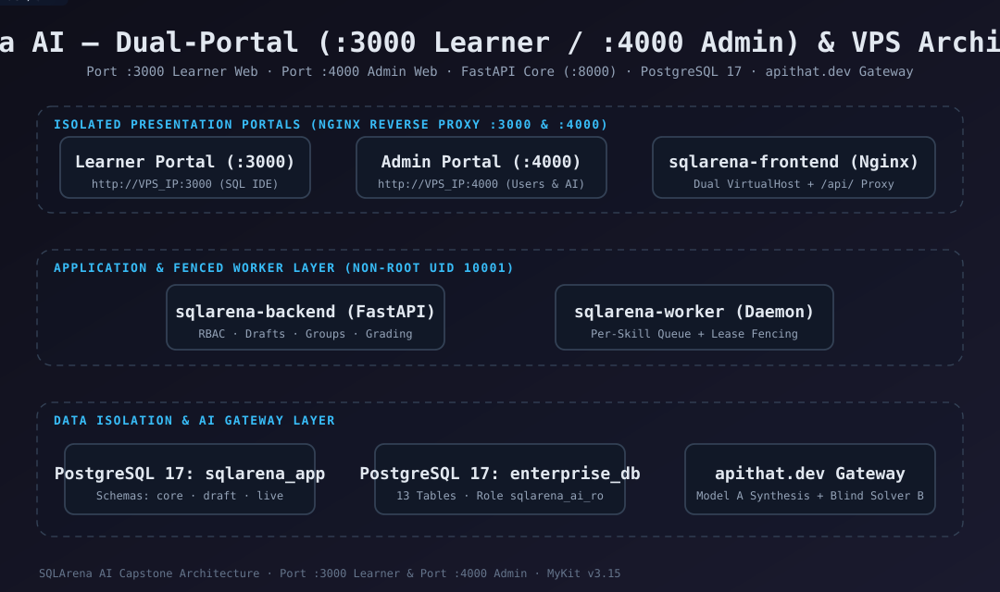
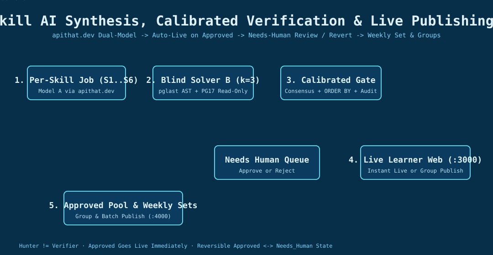

# SQLArena AI — Hệ Thống Tự Động Sinh Đề, Kiểm Định Kép & Chấm Thi SQL Trên PostgreSQL 17

> **Đồ Án Học Viện Công Nghệ Bưu Chính Viễn Thông (PTIT)**  
> Kiến trúc tách biệt **2 Cổng Web Độc Lập (`:3000` Học Viên · `:4000` Quản Trị)**, tích hợp cổng **`https://apithat.dev`**, chuẩn hoá theo **MyKit v3.15**.



---

## 1. Điểm Nhấn Kiến Trúc & Nghiệp Vụ Đồ Án

1. **Tách Biệt Hoàn Toàn 2 Cổng Web Độc Lập (`:3000` & `:4000`)**:
   - **Web Học Viên (`http://<HOST>:3000`)**: Không gian luyện tập tối giản dành riêng cho sinh viên (`Làm bài`, `Tiến độ`, `Xếp hạng`), tuyệt đối không hiển thị nút hay thông báo Quản trị. Thanh tìm kiếm gọn 1 hàng kèm nút `Mở rộng thêm` bộ lọc; lịch sử nộp bài phân loại rõ **`Làm được` / `Không làm được` / `RTE`**; bục vinh danh Olympic đồng bộ 1 tông màu (Hạng 1 cao nhất ở giữa, Hạng 2 bên trái, Hạng 3 bên phải).
   - **Web Quản Trị (`http://<HOST>:4000`)**: Mở trực tiếp tab **`Người dùng`** đầu tiên, quản lý sinh đề theo số lượng riêng từng kỹ năng (`S1..S6`), duyệt đề, gom nhóm câu hỏi `Approved` và quản trị bộ đề tuần.
2. **Kiểm Định Kép Hiệu Chỉnh (`Calibrated Dual-Model Verification` qua `apithat.dev`)**:
   - **Model A (Generator)** sinh đề bài tiếng Việt theo đúng số lượng từng nhóm kỹ năng (`S1–S6`).
   - **Model B (Blind Verifier)** giải độc lập `k = 3` lần trên PostgreSQL 17 chỉ đọc (`sqlarena_ai_ro`), kiểm tra AST `pglast`, đối chiếu đồng thuận kết quả và `ORDER BY`.
3. **Vòng Đời Xuất Bản Linh Hoạt & Có Thể Đảo Ngược (`Approved <-> Needs_Human`)**:
   - Câu hỏi đạt **`approved`** (tự động hoặc do Admin bấm `Phê duyệt` từ `needs_human`) được đưa thẳng lên kệ làm bài đang mở trên Web Học Viên (`:3000`).
   - Với câu hỏi đang `approved`, Admin có thể bấm **`Chuyển về Cần duyệt (needs_human)`** hoặc **`Từ chối bản nháp`** để gỡ ngay lập tức khỏi Web Học Viên, hoặc gom nhiều câu `Approved` tại mục **Bộ đề tuần** để phát hành đồng loạt.



---

## 2. Cấu Trúc Thư Mục Chuẩn MyKit v3.15 (`Zero Markdown Sprawl`)

```text
sqlarena-ai/
├── AGENTS.md / CLAUDE.md          # Cẩm nang điều phối chuẩn MyKit v3.15 (<100 dòng)
├── Dockerfile                     # Multi-layer Python 3.12 non-root runtime (UID 10001)
├── docker-compose.yml             # Cụm 4 containers (:3000 Học viên, :4000 Quản trị, :8000 API, PG17)
├── scripts/
│   ├── deploy-vps.sh              # Triển khai 1 lệnh lên VPS không cần domain + Rollback LKG
│   └── set-apithat-key.sh         # Nạp khóa https://apithat.dev/keys bảo mật Secret-Blind
├── backend/                       # FastAPI + SQLAlchemy 2.x Core + Alembic (0001..0005) + 57 Pytest
├── ai/                            # Động cơ Model A, Model B, AST Validator (pglast) + 104 Unittests
├── frontend/                      # Next.js 16 Static Export + Dual-Port Nginx (:3000/:4000) + DESIGN.md
├── postgre/                       # Kịch bản khởi tạo PostgreSQL 17 & tập dữ liệu enterprise_db
├── question_create/               # Quy tắc phân loại 6 nhóm kỹ năng S1–S6 & 5 miền nghiệp vụ
└── docs/
    ├── LAW.md                     # Bất biến nghiệp vụ, bảo mật Read-Only Sandbox & 6 Invariants
    ├── ARCHITECTURE.md            # Kiến trúc Dual-Port, tích hợp apithat.dev & Ma trận Edge Cases
    ├── WBS.md                     # Phân rã công việc theo pha (Agent + Skill + Gate)
    ├── DECISIONS.md               # Hồ sơ quyết định kiến trúc (ADR-001..ADR-004)
    ├── REVIEW.md                  # Bằng chứng kiểm định tự động & Nhật ký tinh chỉnh UX
    ├── api/OPENAPI_V1.md          # Hợp đồng REST API chuẩn duy nhất (SSOT)
    └── diagrams/*.svg             # Sơ đồ vector xuất bản từ tech-diagramming phục vụ báo cáo
```

---

## 3. Hướng Dẫn Khởi Chạy Với `https://apithat.dev/keys` & Triển Khai VPS

### Bước 1: Gắn khóa API từ `https://apithat.dev/keys`
```bash
./scripts/set-apithat-key.sh
```
*(Hoặc dán trực tiếp vào ô khóa ẩn trong Web Quản trị `http://<HOST>:4000` -> tab **Sinh đề AI** / **Cấu hình**).*

### Bước 2: Khởi chạy Docker Compose (Local hoặc VPS không cần Domain)
Trên VPS Linux, mở cổng `3000` (cho sinh viên) và `4000` (cho giảng viên/quản trị), sau đó chạy:
```bash
./scripts/deploy-vps.sh
```
- **Web Học Viên**: `http://<IP_VPS>:3000` (Tài khoản mẫu: `nguyen_ptit` / `demo123`)
- **Web Quản Trị**: `http://<IP_VPS>:4000` (Tài khoản mẫu: `admin` / `admin123` — vào thẳng mục **Người dùng**)

---

## 4. Cổng Kiểm Chứng Tự Động (`All Exit 0`)

- **Backend Pytest (PostgreSQL 17 thật)**: `(cd backend && ../.venv/bin/pytest -q)`
- **AI Dual-Model & AST Unittests**: `(cd ai && AI_PROVIDER=ollama ../.venv/bin/python -m unittest discover -s . -p "test_*.py" -q)`
- **Frontend Static Export Build**: `(cd frontend && npm run build)`
- **MyKit Quality Gates**: Chi tiết tại [`docs/WBS.md`](docs/WBS.md) & [`docs/REVIEW.md`](docs/REVIEW.md).
