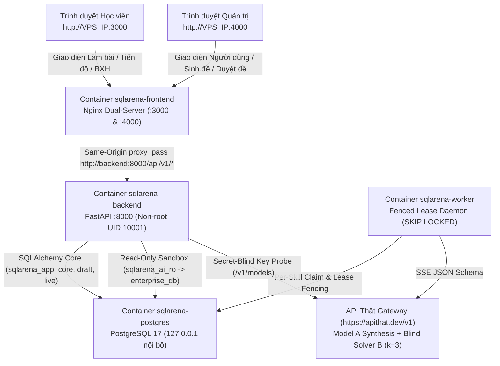

# Kiến Trúc Hệ Thống, Tách Cổng `:3000`/`:4000` & Tích Hợp `apithat.dev` (`docs/ARCHITECTURE.md`)

> Chuẩn hoá theo **MyKit v3.15** — Kết hợp sơ đồ vector SVG xuất bản từ `tech-diagramming` và sơ đồ Mermaid an toàn tuyệt đối trên Dark Mode (`0` khối nền sáng `rect rgb(2xx,...)`).

## 1. Kiến Trúc Tách Cổng Độc Lập (`:3000` Học Viên · `:4000` Quản Trị) Trên VPS

### Giải thích Đời thực → Vận hành Kỹ thuật (`Real-Life Analogy -> Tech Operation`)
- **Hai Cổng Ra Vào Tách Biệt Trong Cùng Tòa Nhà (`:3000` & `:4000`)**: Học viên đi cổng `:3000` chỉ thấy phòng thi, bảng tiến độ (`Làm được` / `Không làm được` / `RTE`) và bục xếp hạng Olympic; Giảng viên đi cổng riêng `:4000` vào thẳng bàn quản lý **Người dùng**, ra đề theo từng kỹ năng `S1–S6` và duyệt đề. Cả hai cổng đều đi qua Nginx nội bộ gọi `/api/v1/*` cùng nguồn, không cần domain và không bao giờ dính lỗi CORS trên VPS.
- **Công Tắc Hai Chiều An Toàn (`Approved <-> Needs_Human`)**: Đề vừa đạt `approved` (tự động hoặc bấm `Phê duyệt`) lập tức hiện lên cổng `:3000` cho sinh viên làm; nếu phát hiện cần chỉnh lại, Admin bấm `Chuyển về Cần duyệt` ở cổng `:4000` là đề được rút khỏi cổng `:3000` ngay trong tích tắc và đánh lại thứ tự liền mạch.

---

## 2. Quy Trình Sinh Đề Theo Kỹ Năng, Kiểm Định Kép & Phát Hành

---

## 3. Ma Trận Đa Luồng & Tình Huống Biên Thực Chiến (`Multi-Flow & Production Scars`)

| Nhóm tình huống | Kịch bản lỗi / Race Condition thực tế | Cơ chế phòng vệ trong Codebase |
| :--- | :--- | :--- |
| **1. Per-Skill Quota Generation** | Admin chọn đồng thời `S1` (2 câu) và `S2` (3 câu) trong 1 lần bấm Tạo đề. | `POST /admin/generation-jobs` nhận `skill_quantities`, kiểm tra tổng trần ngân sách dưới khóa `pg_advisory_xact_lock` và tạo job tách biệt đúng định lượng từng kỹ năng. |
| **2. Reversible Live Approval** | Đề đã `approved` lên kệ `:3000` nhưng Admin bấm `Chuyển về Cần duyệt` hoặc `Từ chối`, sau đó lại sửa và `Phê duyệt` lại. | `return-needs-human` gỡ bản ghi khỏi `live.weekly_set_items`, đánh lại `position = 1..N` liên tục và chuyển `live.questions` sang `retired`; khi `approve` lại, `ON CONFLICT (source_draft_id)` khôi phục `ready` không lỗi trùng khóa. |
| **3. Concurrency Race (Đua tranh đồng thời)** | Hai worker cùng bốc 1 job/draft, hoặc 2 tab Admin thao tác cùng lúc. | Hàng đợi dùng `FOR UPDATE SKIP LOCKED` + fencing token `lease_version` (`LeaseLost` tự hủy ghi đè nếu worker cũ mất lease). |
| **4. Gateway Truncation / Transient Syntax** | 1/3 mẫu giải của Model B lỗi cú pháp thoáng qua hoặc khóa API hết hạn (`401`). | Nâng `max_tokens` (`1500/1200`), bật `REVIEW_REPAIR_ROUNDS=1`, chế độ `calibrated` duyệt khi `>=2/3` mẫu hợp lệ đồng thuận 100% kết quả (`0` mẫu đối kháng). |
| **5. Tampering & BOLA / Zero-Leak** | Học viên chèn `DROP TABLE`, `; SELECT`, comment `--`, hoặc truy cập câu ngoài kệ. | `_strip_sql_comments()` lọc sạch comment ngoài chuỗi, chặn mọi từ khóa ghi và ép `SET LOCAL TRANSACTION READ ONLY`. Câu ngoài kệ trả `404`; chỉ trả `output_columns`. |
| **6. VPS & BuildKit Unicode Scars** | Thư mục chứa dấu tiếng Việt làm lỗi header gRPC của Docker BuildKit; xung đột port `5432`/`3000`/`4000`. | `deploy-vps.sh` tự phát hiện đường dẫn Unicode bật `DOCKER_BUILDKIT=0`, dùng `.dockerignore` nén context `<2MB`, và khóa Postgres vào `127.0.0.1`. |
