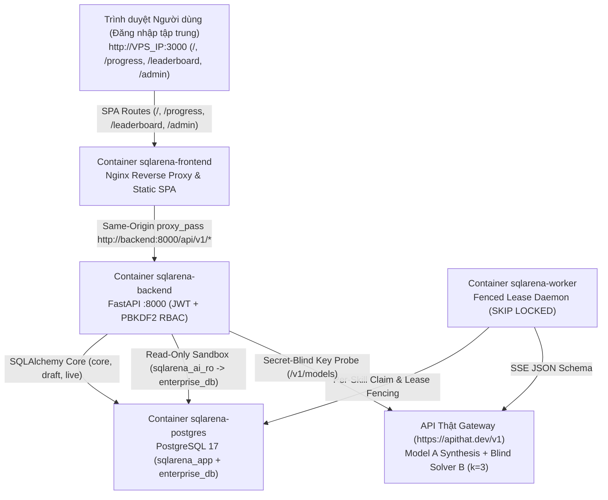

# Kiến Trúc Hệ Thống, Đăng Nhập Tập Trung `RBAC` & Tích Hợp `apithat.dev` (`docs/ARCHITECTURE.md`)

> Chuẩn hoá theo **MyKit v3.15** — Kết hợp sơ đồ vector SVG xuất bản từ `tech-diagramming` và sơ đồ Mermaid an toàn tuyệt đối trên Dark Mode (`0` khối nền sáng `rect rgb(2xx,...)`).

## 1. Kiến Trúc Cổng Web Thống Nhất, Phân Quyền Đường Dẫn (`RBAC`) & Dữ Liệu Thật

### Giải thích Đời thực → Vận hành Kỹ thuật (`Real-Life Analogy -> Tech Operation`)
- **Một Sảnh Lễ Tân Duy Nhất, Phân Tầng Bằng Thẻ Từ (`Unified Login + Path RBAC`)**: Sinh viên và Giảng viên đều bước vào cùng 1 sảnh đăng nhập (`http://<HOST>:3000/`). Hệ thống kiểm tra băm mật khẩu `PBKDF2-HMAC-SHA256` và vai trò trong `live.roles`: thẻ Học viên (`learner`) mở các tầng `/`, `/progress`, `/leaderboard` (tự động chặn `/admin`); thẻ Quản trị viên (`admin`) mở được toàn bộ các tầng luyện tập của học viên **cộng thêm** tầng điều hành `/admin` mà không cần cổng đăng nhập riêng.
- **Kho Chờ Lên Kệ & Công Tắc Thu Hồi An Toàn (`Unassigned Approved Pool <-> Published Shelf`)**: Đề đạt `approved` (do AI kiểm định hoặc Admin bấm `Phê duyệt`) được lưu vào kho `Chưa có trên kệ` (`live.questions` ở trạng thái `ready`, chưa gắn vào `live.weekly_set_items`) để Admin chủ động gom bộ và bấm `Đăng` trong mục `Bộ đề tuần`. Nếu một đề đã đăng cần chỉnh lại, Admin bấm `Chuyển về Cần duyệt` hoặc `Từ chối` là hệ thống tự động gỡ khỏi kệ Học viên và đánh lại thứ tự `1..N` liền mạch.

---

## 2. Quy Trình Sinh Đề Theo Kỹ Năng, Kiểm Định Kép & Phát Hành

---

## 3. Ma Trận Đa Luồng & Tình Huống Biên Thực Chiến (`Multi-Flow & Production Scars`)

| Nhóm tình huống | Kịch bản lỗi / Race Condition thực tế | Cơ chế phòng vệ trong Codebase |
| :--- | :--- | :--- |
| **1. Per-Skill Quota Generation** | Admin chọn đồng thời `S1` (2 câu) và `S2` (3 câu) trong 1 lần bấm Tạo đề. | `POST /admin/generation-jobs` nhận `skill_quantities`, kiểm tra tổng trần ngân sách dưới khóa `pg_advisory_xact_lock` và tạo job tách biệt đúng định lượng từng kỹ năng. |
| **2. Reversible Live Approval** | Đề đã `approved` lên kệ `:3000` nhưng Admin bấm `Chuyển về Cần duyệt` hoặc `Từ chối`, sau đó lại sửa và `Phê duyệt` lại. | `return-needs-human` gỡ bản ghi khỏi `live.weekly_set_items`, đánh lại `position = 1..N` liên tục và chuyển `live.questions` sang `retired`; khi `approve` lại, `ON CONFLICT (source_draft_id)` khôi phục `ready` không lỗi trùng khóa. |
| **3. Concurrency Race (Đua tranh đồng thời)** | Hai worker cùng bốc 1 job/draft, hoặc 2 tab Admin thao tác cùng lúc. | Hàng đợi dùng `FOR UPDATE SKIP LOCKED` + fencing token `lease_version` (`LeaseLost` tự hủy ghi đè nếu worker cũ mất lease). |
| **4. Gateway Truncation / Transient Syntax** | 1/3 mẫu giải của Model B lỗi cú pháp thoáng qua hoặc khóa API hết hạn (`401`). | Nâng `max_tokens` (`1500/1200`), bật `REVIEW_REPAIR_ROUNDS=1`, chế độ `calibrated` duyệt khi `>=2/3` mẫu hợp lệ đồng thuận 100% kết quả (`0` mẫu đối kháng). |
| **5. Tampering & BOLA / Zero-Leak** | Học viên chèn `DROP TABLE`, `; SELECT`, comment `--`, hoặc truy cập câu ngoài kệ. | `_strip_sql_comments()` lọc sạch comment ngoài chuỗi, chặn mọi từ khóa ghi và ép `SET LOCAL TRANSACTION READ ONLY`. Câu ngoài kệ trả `404`; chỉ trả `output_columns`. |
| **6. VPS & BuildKit Unicode Scars** | Thư mục chứa dấu tiếng Việt làm lỗi header gRPC của Docker BuildKit; xung đột port `5432`/`3000`/`4000`. | `deploy-vps.sh` tự phát hiện đường dẫn Unicode bật `DOCKER_BUILDKIT=0`, dùng `.dockerignore` nén context `<2MB`, và khóa Postgres vào `127.0.0.1`. |
