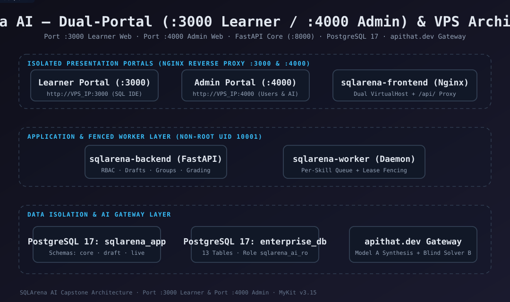
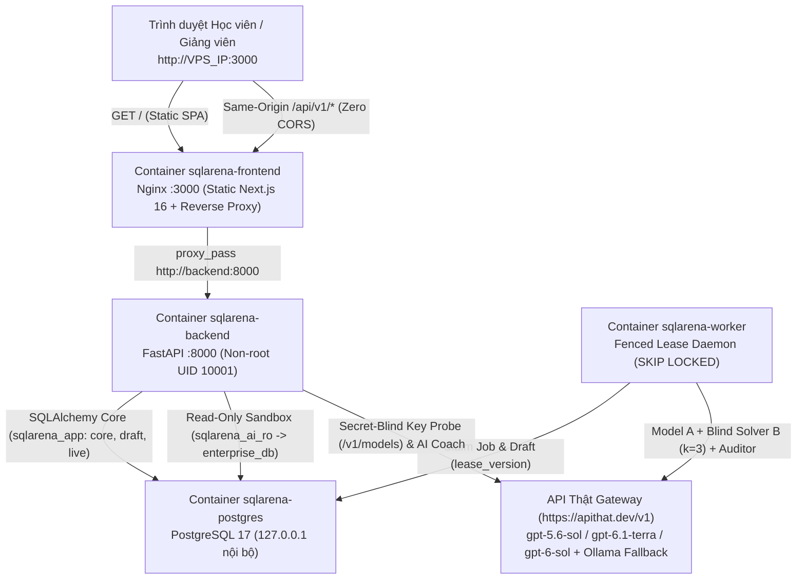
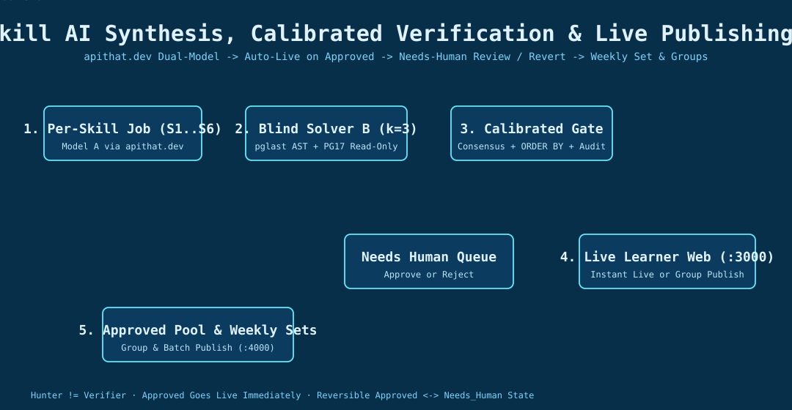

# Kiến Trúc Hệ Thống, Tích Hợp `apithat.dev` & Đa Luồng Sự Cố (`docs/ARCHITECTURE.md`)

> Chuẩn hoá theo **MyKit v3.15** — Kết hợp sơ đồ vector SVG xuất bản từ `tech-diagramming` và sơ đồ Mermaid an toàn tuyệt đối trên Dark Mode (`0` khối nền sáng `rect rgb(2xx,...)`).

## 1. Kiến Trúc 4 Tầng & Định Tuyến VPS Không Cần Domain (`http://<VPS_IP>:3000`)

### Giải thích Đời thực → Vận hành Kỹ thuật (`Real-Life Analogy -> Tech Operation`)
- **Quầy Lễ Tân Một Cửa (`Nginx :3000` Reverse Proxy)**: Khách từ ngoài internet chỉ cần đi vào đúng cổng `3000` (`http://<VPS_IP>:3000`). Mọi yêu cầu `/api/v1/*` được lễ tân Nginx chuyển nội bộ sang phòng xử lý `http://backend:8000`, nhờ đó không bao giờ bị lỗi trình duyệt gọi nhầm về `127.0.0.1:8000` trên máy cá nhân của người xem và không cần mở cổng `8000` hay `5432` ra ngoài VPS.
- **Tủ Giữ Nóng → Khay Gom Món → Bàn Phục Vụ (`Ready Pool -> Question Group -> Published Shelf`)**: Đề vừa vượt kiểm duyệt (`approved`) được cất vào **Kho Đề Sẵn Sàng (`live.questions`)**, không tự nhảy lẻ tẻ ra màn hình học viên. Giảng viên kéo thả hoặc tick chọn nhiều câu vào một **Nhóm Đề (`live.question_groups`)** rồi bấm **Đăng toàn bộ nhóm** 1 lần để phát hành đồng loạt.

---

## 2. Quy Trình Kiểm Định Kép Hiệu Chỉnh & Tích Hợp Cổng `apithat.dev`

### Cơ chế điều phối khóa `https://apithat.dev/keys` (`backend/app/pipeline/engine.py`)
1. **Nạp khóa Secret-Blind đa tầng**: Đọc theo thứ tự ưu tiên `Runtime Vault Override` > biến môi trường Docker > `backend/.env` / `.env` > `~/.mykit/vault.env` (quyền `0600`), không bao giờ trả khóa thô qua API hay ghi vào `live.audit_logs`.
2. **Tự động khám phá Model theo nhóm khóa (`probe_apithat_key`)**: Gọi `GET https://apithat.dev/v1/models` (cache 5 phút theo mã băm SHA-256 của khóa), lọc bỏ model tạo ảnh/âm thanh và xếp ưu tiên các model lập trình/SQL có độ ổn định cao trên `apithat.dev` (`gpt-5.6-sol`, `gpt-6.1-terra`, `gpt-6-sol`, `gpt-6-astra`, `claude-sonnet-5-5`).
3. **Tương thích đa giao thức**: Tự động định tuyến dòng GPT/Qwen/DeepSeek/Gemini qua `/v1/chat/completions` (SSE streaming & JSON extraction) và dòng Claude qua `/v1/messages` (`anthropic-version: 2023-06-01`).

---

## 3. Ma Trận Đa Luồng & Tình Huống Biên Thực Chiến (`Multi-Flow & Production Scars`)

| Nhóm tình huống | Kịch bản lỗi / Race Condition thực tế | Cơ chế phòng vệ trong Codebase |
| :--- | :--- | :--- |
| **1. Happy Path (Gom nhóm & Đăng 1 lần)** | Giảng viên kéo thả / chọn 5 câu `ready` vào nhóm rồi bấm Đăng. | `groups.publish()` khóa `FOR UPDATE`, kiểm tra `test_cases` khớp `dataset_version` và gắn nguyên tử toàn bộ câu vào kệ đang mở (`append_active`) hoặc bộ tuần mới (`new_weekly_set`). |
| **2. Concurrency Race (Đua tranh đồng thời)** | Hai worker cùng bốc 1 job/draft, hoặc 2 tab Admin bấm `Publish` cùng lúc. | Dùng `FOR UPDATE SKIP LOCKED` kèm fencing token `lease_version` (`LeaseLost` tự hủy ghi đè nếu hết hạn lease). |
| **3. Gateway Truncation / Transient Syntax** | 1/3 mẫu giải của Model B lỗi cú pháp thoáng qua hoặc khóa API hết hạn (`401`). | Nâng `max_tokens` (`1500/1200`), bật `REVIEW_REPAIR_ROUNDS=1`, chế độ `calibrated` duyệt khi `>=2/3` mẫu hợp lệ đồng thuận 100% kết quả (`0` mẫu đối kháng). Nếu khóa `401` hoặc timeout 2 slot liên tiếp -> dừng nhanh không đốt ngân sách. |
| **4. Async State Skew (Thu hồi đề giữa chừng)** | Câu hỏi trong nhóm nháp bị Admin bấm `Retire` trước khi đăng nhóm. | `groups.publish()` tái kiểm tra `status == 'ready' AND NOT is_flagged` ngay trong transaction, trả `409 GROUP_NOT_PUBLISHABLE` chỉ rõ ID câu lỗi. |
| **5. Tampering & BOLA / Zero-Leak** | Học viên chèn `DROP TABLE`, `; SELECT`, comment `--`, hoặc dò ID câu ngoài kệ. | `_strip_sql_comments()` lọc sạch comment ngoài chuỗi, chặn mọi từ khóa ghi và ép `SET LOCAL TRANSACTION READ ONLY`. Câu ngoài kệ trả `404`; chỉ trả tên cột `output_columns`. |
| **6. VPS & BuildKit Unicode Scars** | Thư mục chứa dấu tiếng Việt làm lỗi header gRPC của Docker BuildKit; xung đột port `5432`/`3000`. | `deploy-vps.sh` và `start.sh` tự phát hiện đường dẫn Unicode bật `DOCKER_BUILDKIT=0`, dùng `.dockerignore` nén context còn `<2MB`, và khóa Postgres vào `127.0.0.1`. |
